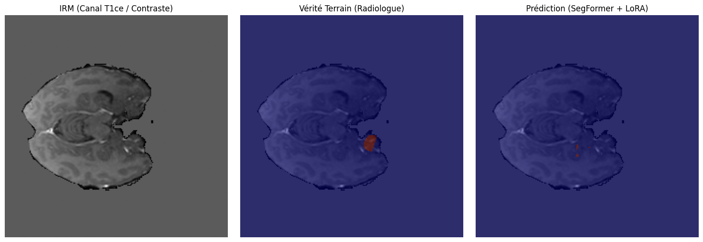

# Segmentation de tumeurs cérébrales par IRM (Dataset BraTS)

> **Note :** Ce projet a initialement été développé et exécuté sur un notebook **Google Colab** (pour profiter d'un GPU T4 lors du téléchargement et du traitement des volumes IRM). Je l'ai nettoyé et importé ici afin de centraliser l'ensemble de mes projets IA au même endroit sur mon GitHub.

---


## Pourquoi ce projet ?

Après avoir pas mal travaillé sur le fine-tuning de modèles de langage (LLM / SLM avec LoRA et GRPO), j'ai voulu voir comment transposer ces méthodes d'adaptation légère à la vision par ordinateur et plus particulièrement à l'imagerie médicale.

En milieu hospitalier, annoter des IRM 3D coupe par coupe demande énormément de temps aux radiologues. On se retrouve souvent avec de petits jeux de données sur lesquels un réseau de neurones classique entraîné en partant de zéro a tendance à sur-apprendre.

L'idée de ce dépôt est donc simple : comparer une architecture médicale classique (Attention U-Net) face à un Vision Transformer, le tout sur la segmentation des différentes zones d'une tumeur cérébrale).

---

## Les données

Le script utilise automatiquement le dataset Task01_BrainTumour via la librairie MONAI. Chaque patient dispose de 4 séquences d'IRM 3D complémentaires. 

Pour pouvoir utiliser des modèles de vision pré-entraînés (qui attendent 3 canaux, comme une image RGB classique) et garder un temps d'entraînement raisonnable sur un seul GPU, j'ai construit un pipeline 2D qui :
1. Sélectionne les 3 modalités les plus riches cliniquement : FLAIR (œdème), T1ce (tumeur active avec agent de contraste) et T2 (structure interne).
2. Normalise les intensités magnétiques (Z-score par volume).
3. Extrait les coupes axiales 2D pertinentes contenant effectivement des tissus tumoraux.

## Ce que j'ai testé

1. Architecture : Attention U-Net vs ViT + LoRA

 Entraînement complet de 100 % des poids du modèle en partant de zéro. Le modèle de base est gelé. J'injecte uniquement des adaptateurs LoRA ($r=8$)dans les couches d'attention (`query`, `key`, `value`) via Hugging Face `PEFT`, tout en laissant la tête de décodage s'adapter à nos 4 classes. Résultat : on n'entraîne qu'une petite fraction des paramètres totaux.

2. Gestion du déséquilibre des classes (Dice + Focal Loss)

Sur une coupe d'IRM, plus de 95 % de l'image correspond à du cerveau sain ou au fond noir. Pour éviter que le modèle n'ignore les petites structures, j'utilise une perte hybride DiceFocalLoss

---

## Résultats obtenus

Évaluation réalisée sur le jeu de validation (non vu à l'entraînement) avec les deux métriques standards du domaine : le **Coefficient de Dice** (chevauchement) et la **Distance de Hausdorff au 95e centile (HD95)** (précision des contours).

| Modèle | Paramètres entraînés | Score Dice Moyen | Dice (Œdème / Nécrose / Tumeur active) | HD95 Moyen (px) |
| :--- | :---: | :---: | :---: | :---: |
| **Attention U-Net (Baseline)** | 100 % | 62.8 % | 72.9 % / 42.1 % / 73.4 % | 11.01 px |
| **SegFormer-B2 + LoRA ($r=8$)** | ~4.5 % | **60.5 %** | **70.9 % / 40.8 % / 69.8 %** | **10.48 px** |

---

## Lancer le projet

Si vous souhaitez relancer l'expérience (sur Google Colab ou en local avec un GPU) :

```bash

pip install "monai[nibabel,tqdm]" torch torchvision transformers peft matplotlib scikit-learn

python brats_lora_vs_unet.py

```
## Résultats visuels

Voici un exemple de coupe axiale extraite du jeu de validation comparant l'IRM d'entrée, la vérité terrain du radiologue et la prédiction de notre modèle SegFormer + LoRA :

